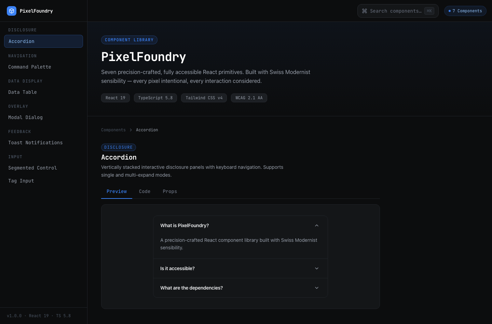
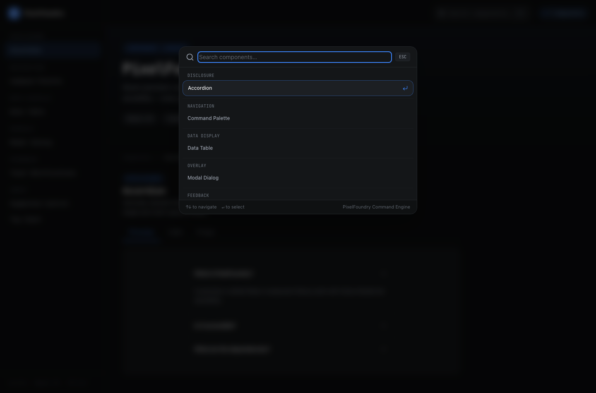
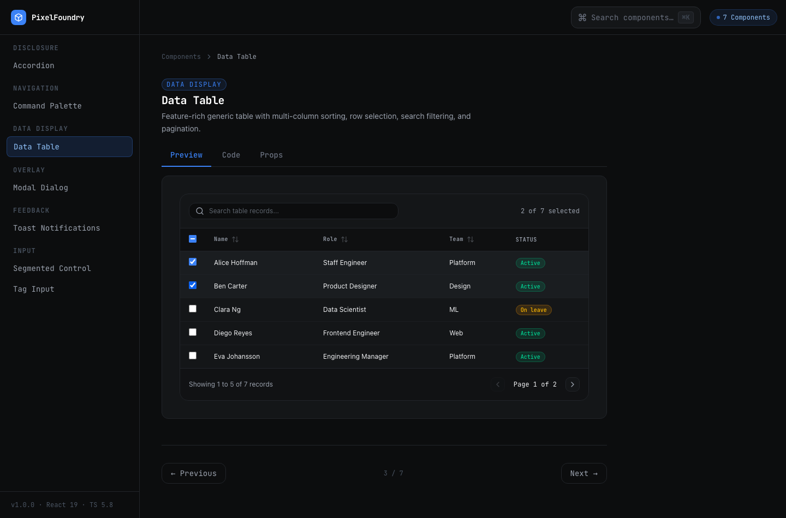
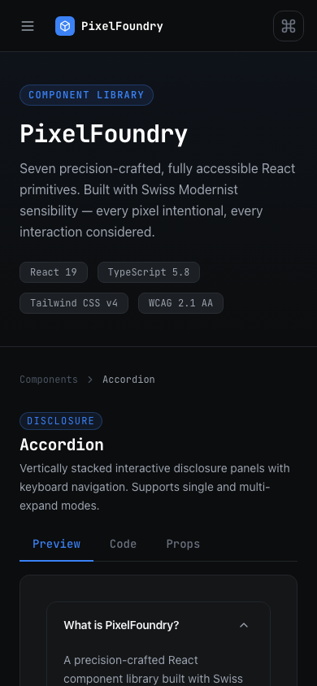

# PixelFoundry — Accessible React Component Library

> A precision-crafted, zero-headless-dependency React 19 component library engineered with Swiss Modernist / Bauhaus sensibility. Built for high-density professional web applications with full WAI-ARIA 1.2 keyboard and screen-reader accessibility.

[](https://react.dev)
[](https://www.typescriptlang.org)
[](https://tailwindcss.com)
[](https://vitest.dev)
[](https://oxc-project.github.io)
[](https://www.netlify.com)
[](https://www.w3.org/WAI/standards-guidelines/wcag/)



---

## 📐 Design Philosophy

PixelFoundry takes inspiration from the **Swiss International Typographic Style (Bauhaus / Swiss Modernism)**:
- **Graphite Canvas**: Deep, measured surface hierarchy (`#0C0D0E` base canvas, `#141618` card surfaces, `#1C1F23` interactive states, `#22252A` crisp architectural dividing borders).
- **Klein Blue Accent**: High-contrast `#3B82F6` cobalt blue accent reserved strictly for interactive focus, selection highlights, and intentional points of interest.
- **Monospaced Utility**: JetBrains Mono typography for high-density data, code samples, hotkey combos, and component spec tables.
- **Zero Headless bloat**: Implemented using pure React 19 primitives with manual keyboard event state machines and focus management — no Radix, Headless UI, or Ark UI dependencies required.

---

## 🗂️ Component Architecture

PixelFoundry ships seven core primitives and an interactive component workbench:

| Primitive | Category | Key Capabilities | WAI-ARIA Pattern |
|---|---|---|---|
| **Accordion** | Disclosure | Single or multi-expand modes, keyboard arrow nav, smooth height transition | `disclosure` / `accordion` |
| **CommandPalette** | Navigation | Fuzzy search filter, category grouping, hotkey badges, ⌘K trigger, arrow navigation | `combobox` + `listbox` |
| **DataTable** | Data Display | Generic TypeScript typing, multi-column sorting, row checkboxes, client-side pagination, search | `table` + `aria-sort` |
| **ModalDialog** | Overlay | Focus trapping (`Tab`/`Shift+Tab`), scroll locking, ESC dismissal, backdrop click control, customizable sizes | `dialog` (`aria-modal="true"`) |
| **Toast & ToastViewport** | Feedback | Context-driven dispatch (`useToast()`), auto-dismiss timer, progress countdown, 4 semantic variants | `status` (`aria-live="polite"`) |
| **SegmentedControl** | Input | Animated pill indicator sliding between segments, left/right keyboard navigation | `radiogroup` (`role="radio"`) |
| **TagInput** | Input | Multi-token text input, Enter/comma commit, Backspace-to-delete, duplicate prevention, max count limit | `group` (`aria-label`) |

---

## 📸 Visual Walkthrough

### 1. Interactive Component Catalog (`desktop-home.png`)
The primary desktop catalog layout displaying the Swiss Modernist sidebar, live interactive preview, code snippets with one-click copy, and component props specification tables.


### 2. VS Code-Style Command Palette (`desktop-main-feature.png`)
Quick-access launcher launched via global `⌘K` or top-bar search button. Categorized navigation items, hotkey indicators, keyboard navigation, and instant execution.



### 3. Data Table & Workbench (`desktop-workbench.png`)
High-density generic data table with multi-column sorting, batch row selection checkboxes, query filtering, and responsive pagination controls.



### 4. Responsive Mobile Experience (`mobile-home.png`)
Adaptive 390px mobile viewport with responsive drawer navigation, touch-friendly segmented controls, and accessible tokenized inputs.



---

## 🛠️ Tech Stack & Tooling

- **Core**: React 19, TypeScript 5.8 (`verbatimModuleSyntax`, strict mode)
- **Styling**: Tailwind CSS v4 (`@tailwindcss/vite`, CSS `@theme` design tokens)
- **Icons**: Lucide React
- **Bundler**: Vite 6.2 (ESM library + SPA build targets)
- **Testing**: Vitest 3.0 + `@testing-library/react` + `@testing-library/jest-dom` + `jsdom` (42 comprehensive unit tests)
- **Visual Validation**: Playwright (automated Chromium screenshots in 1440px desktop & 390px mobile viewports)
- **Linter**: Oxlint (instant Rust-based linter with 0 warnings)
- **Deployment**: Netlify (`netlify.toml` with SPA redirects and security headers)

---

## 🧪 Testing & Verification

PixelFoundry includes 42 verified unit tests covering accessibility semantics, keyboard navigation states, edge cases, and user interactions:

```bash
# Run Vitest unit tests
pnpm test

# Run Oxlint static analysis
pnpm lint

# Build production bundle
pnpm build

# Capture automated Playwright screenshots
pnpm screenshots
```

### Test Coverage Highlights:
- **Accordion**: Header keyboard navigation (`ArrowUp`/`ArrowDown`/`Home`/`End`), `aria-expanded` toggling, disabled item bypass, single vs. multi-expand logic.
- **CommandPalette**: Open/close lifecycle, fuzzy query filtering, keyboard item execution, empty state fallback.
- **DataTable**: Column sort cycle (`asc` ➔ `desc` ➔ none), query-based row filtering, page slice math, batch row selection state.
- **ModalDialog**: ARIA landmark attributes, backdrop click behavior, close button events.
- **Toast**: Provider context dispatching, auto-dismiss timers, variant rendering, custom action callbacks, error boundaries.

---

## 📦 Getting Started

### Installation

```bash
pnpm install
```

### Development Server

```bash
pnpm dev
```

### Production Build

```bash
pnpm build
```

---

## 📄 License

MIT © [Developer](https://github.com)
